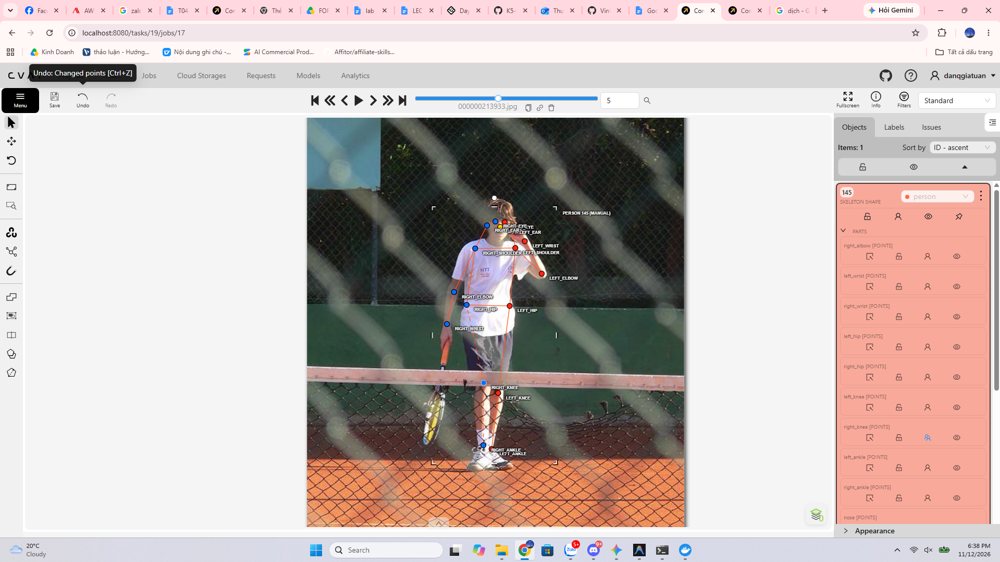
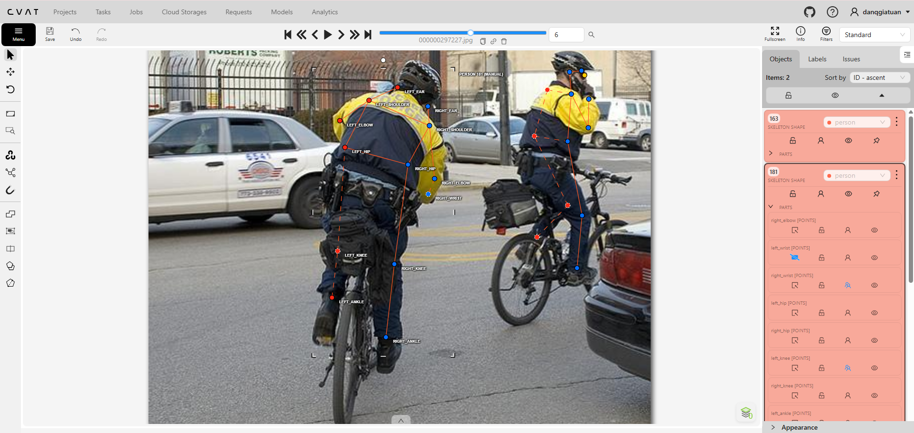
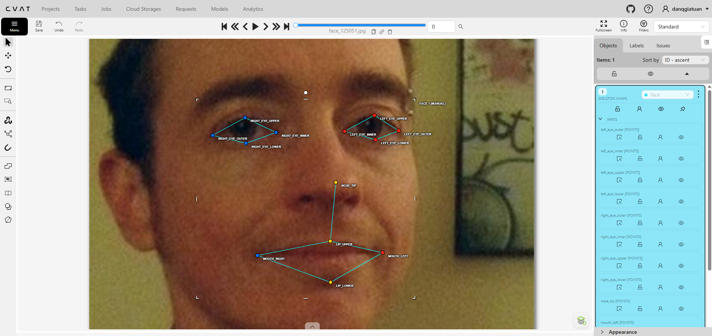
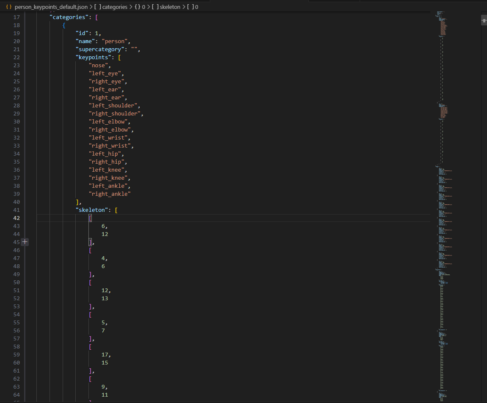

# Báo cáo cá nhân — Đặng Gia Tuấn — 2A202603067

Dữ liệu: 12 ảnh người và 8 ảnh mặt được giao trong `src/exports/assignment.json`; nguồn ảnh gốc là COCO 2017 theo `src/lab/NGUON_ANH.md`. Các số liệu dưới đây lấy từ hai ZIP xuất hiện có, không phải nhật ký thao tác CVAT.

## 0. Thông tin học viên

- Họ tên: Đặng Gia Tuấn 
- MSSV: `2A202603067`.
- Email: `danggiatuan.work@gmail.com`.
- Link repository: `https://github.com/devdanqtuan/K5-L2-DAY04-DangGiaTuan-2A202603067-KeypointPose` 
- Phiên bản CVAT: **2.74.1**
- Máy: Windows · RAM 32Gb DDR5 · chế độ CVAT đầy đủ.
- Bộ ảnh (`src/exports/assignment.json` do `lab.py setup` tạo): **có**, `pool_version = d04-k5-v2`, task `persons-DangGiaTuan` và `faces-DangGiaTuan`.
- Giờ bắt đầu: **16:15**.
- Giờ kết thúc: **19:30**.

## 1. Kiểm tra label (CP0)

| Label | Kiểu | Số điểm | Tên điểm đúng bảng của lab? | Đúng thứ tự? | Số cạnh |
|---|---|---:|---|---|---:|
| `person` | Skeleton | 17 | Có, đối chiếu JSON label và ZIP | Có | 19 |
| `face` | Skeleton | 13 | Có, đối chiếu JSON label và ZIP | Có | 13 |

Mẫu `person` trong `labels_d04_keypoint.json` dựng theo người quay mặt về camera: **có**; các điểm `left_*` nằm bên phải khung mẫu.

Cách đổi cờ `occluded` / `outside` cho **một điểm** trên phiên bản CVAT này (một câu):

Rê chuột lên đúng điểm của skeleton, bấm `Q` để bật/tắt `occluded` (`v = 1`) hoặc `O` để bật/tắt `outside` (`v = 0`), rồi lưu bằng `Ctrl+S`.

## 2. Số lượng đã gán và thời gian (CP1, CP2)

| Nhóm ảnh | Số ảnh | Số skeleton đã gán | Số người dưới 60 px (không gán) | Số poster / gương / màn hình bỏ qua | Thời gian (phút) |
|---|---:|---:|---:|---:|---:|
| `easy` | 5 | 5 | 0 | 0 | 20 |
| `occluded` | 3 | 7 | 0 | 0 | 18 |
| `back` | 2 | 4 | 0 | 0 | 10 |
| `small` | 1 | 1 | 0 | 0 | 5 |
| `crowd` | 1 | 2 | 1 | 0 | 7 |
| `faces` | 8 | 8 | — | 0 | 30 |

- Số ảnh người đã xong ở mốc phút 105: 10 / 10.
- Thời gian thực tế (phút): CP1 **60** · CP2 **30** · CP3 **30**.
- Ảnh tốn thời gian nhất và lý do: Ảnh `000000188804.jpg` tốn thời gian nhất vì người ngồi sau chiếc bàn, cần phải dự đoán những điểm có thể đoán được.

## 3. Bảng ca khó (CP1, CP2)

Mỗi điểm bạn phân vân một dòng, nhất là phân vân giữa `v = 1` và `v = 0`, hoặc không chắc hướng người.

| Ảnh | Người / mặt | Điểm | Cờ đã chọn | Phân vân giữa | Lý do chọn |
|---|---|---|---:|---|---|
| `000000188804.jpg` | Người ngồi sau bàn (#1) | `left_knee` | 1 | `v = 1` và `v = 0` | Bị mặt bàn che khuất nhưng dựa vào hướng đùi và vị trí mép bàn có thể ước lượng chắc chắn vị trí khớp gối |
| `000000438099.jpg` | Người ngồi sau laptop | `left_hip`, `right_hip` | 1 | `v = 1` và `v = 0` | Bị thành cửa xe che khuất nhưng dóng từ trục vai xuống theo tư thế ngồi lái xe có thể suy ra vị trí hông |

## 4. Bảng tự review (CP3)

Đi từ ảnh cuối về ảnh đầu. 5 ảnh người (ít nhất 2 ảnh `back` hoặc `crowd`) và 3 ảnh mặt. Ít nhất 8 dòng, kể cả dòng `ok`. Ghi lỗi trước, sửa sau.

Mã lỗi dùng đúng một trong: `lr_swap`, `vis_flag`, `position`, `missing`, `extra`, `ok`.

| Ảnh | Người / mặt | Điểm | Mã lỗi | Ghi chú | Đã sửa? |
|---|---|---|---|---|---|
| `000000461389.jpg` | Người (occluded) | `left_shoulder` | `position` | Tọa độ mỏm vai hơi lệch ra ngoài, đã chỉnh lại vào tâm khớp xương vai | Có |
| `000000438099.jpg` | Người (small) | `right_shoulder` | `vis_flag` | Ban đầu để v = 0 do không nhìn thấy, sau chuyển sang v = 1 vì có thể đoán được dựa vào kích thước cơ thể | Có |
| `000000297227.jpg` | Người (back) | `left_wrist`, `right_wrist` | `lr_swap` | Người quay lưng nên ban đầu nhầm cổ tay trái sang bên phải ảnh, đã tráo lại cặp left_wrist / right_wrist | Có |
| `000000130816.jpg` | Người (crowd) | Toàn bộ 17 điểm | `ok` | Đã rà soát chi tiết, đường nối bộ xương không bị chéo hay vắt sang người bên cạnh | Có |
| `000000123544.jpg` | Người (back) | `left_knee`, `right_knee` | `lr_swap` | Đã hoán đổi vị trí chân trái/phải theo đúng hệ quy chiếu người quay lưng | Có |
| `face_560282.jpg` | Mặt (tóc che) | `left_eye_upper` | `vis_flag` | Mí trên bị tóc che nhưng ban đầu để v = 2, đã đổi sang cờ occluded (v = 1) | Có |
| `face_146049.jpg` | Mặt (kính râm) | 8 điểm mắt | `ok` | 8 điểm mắt sau tròng kính râm tối đã đặt cờ occluded (v = 1) đúng chuẩn | Có |
| `face_575921.jpg` | Mặt (thẳng) | Toàn bộ 13 điểm | `ok` | Mắt trái ở bên phải ảnh, khóe và mí đặt chuẩn mép, không có lỗi | Có |

Tổng hợp số lỗi theo mã:

| `lr_swap` | `vis_flag` | `position` | `missing` | `extra` | `ok` |
|---:|---:|---:|---:|---:|---:|
| 2 | 2 | 1 | 0 | 0 | 3 |

Điểm còn phân vân giữa `v = 1` và `v = 0` (ghi cả hai lựa chọn và lý do chọn):

Ở ảnh `000000438099.jpg` từ phần right/left hip trở xuống sẽ chọn `v = 0` vì không còn nhìn thấy được nữa, những phần `v = 1` sẽ là những phần có thể ước lượng được dựa vào tỉ lệ giải phẫu của cơ thể.


## 5. Kiểm file xuất và kết quả tự kiểm (CP4)

Đối chiếu trực tiếp mảng trong hai ZIP hiện có (cần bạn tự mở lại ba annotation này để hoàn tất bước **tự kiểm tay** của CP4):

| File | Người / mặt kiểm (ảnh, thứ tự) | Số phần tử `keypoints` | Điểm `outside` ra `v = 0`, `occluded` ra `v = 1`? | `num_keypoints` khớp? |
|---|---|---:|---|---|
| `DangGiaTuan_persons.zip` | `000000123544.jpg #1` | 51 | `left_ankle = (-32,76; 247,94; 0)`, `left_eye = (91,58; 89,92; 1)` | Có: 16 điểm `v > 0`, `num_keypoints = 16` |
| `DangGiaTuan_persons.zip` | `000000438099.jpg #1` | 51 | `right_ear = (455,94; 223,08; 0)`, `left_eye = (465,46; 176,59; 1)` | Có: 11 điểm `v > 0`, `num_keypoints = 11` |
| `DangGiaTuan_faces.zip` | `face_146049.jpg #1` (ảnh kính râm) | 39 | 8 điểm mắt có `v = 1`, không có `v = 0` | Có: 13 điểm `v > 0`, `num_keypoints = 13` |

Trong ZIP, `occluded` tương ứng `v = 1` và `outside` tương ứng `v = 0`. Cả **47 điểm `v = 0`** trong file `persons` vẫn mang tọa độ khác `(0, 0)`; đây là cách CVAT 2.x xuất điểm `outside`, không phải lỗi định dạng.

Hai job đã chuyển sang `completed` trên CVAT? **Đã chuyển sang**.

Phần **TÓM TẮT** dựng lại từ hai ZIP bằng đúng các phép đếm của `src/check_submission.py` (nên thay bằng output trực tiếp sau lần `lab.py export` cuối):

```text
- File person: DangGiaTuan_persons.zip
  Số ảnh: 12 · số skeleton `person`: 19 · mỗi annotation 51 số
  Skeleton theo ảnh: 000000043968=1, 000000103970=1, 000000123544=2, 000000130816=2, 000000188804=2, 000000213933=1, 000000297227=2, 000000311497=2, 000000390585=1, 000000399983=1, 000000438099=1, 000000461389=3
  Cờ v: v=2 232 (72%) · v=1 44 (14%) · v=0 47 (15%)
  num_keypoints trung bình: 14.5
- File face: DangGiaTuan_faces.zip
  Số ảnh: 8 · số skeleton `face`: 8 · mỗi annotation 39 số
  Skeleton theo ảnh: face_125051=1, face_143959=1, face_146049=1, face_415073=1, face_53580=1, face_560282=1, face_575921=1, face_85624=1
  Cờ v: v=2 94 (90%) · v=1 10 (10%) · v=0 0 (0%)
  num_keypoints trung bình: 13.0
- Ghi chú: 47 điểm v = 0 vẫn mang tọa độ cũ (CVAT 2.x xuất như vậy; chuẩn COCO ghi 0, 0). Không phải lỗi: điểm v = 0 bị bỏ qua khi huấn luyện và khi chấm.
- Số [LỖI]: 0 · số [CẢNH BÁO]: 5
Kết quả: ĐẠT (đọc lại từng cảnh báo ở trên)
```

Các cảnh báo trái/phải chỉ là dấu hiệu hình học: chân bắt chéo thật cũng có thể kích hoạt, nên chưa thể kết luận đó là lỗi gán nhãn nếu chưa xem ảnh.

## 6. Ảnh chụp màn hình

1. Label `person` trong label constructor (đủ 17 điểm có tên):

   


2. Một người quay lưng đã gán, cờ đã đặt:

   

3. Một khuôn mặt đã gán 13 điểm, phóng to vùng mắt:

   


4. Một đoạn JSON xuất của một người:

   


Nguồn ảnh: COCO val2017 / Wikimedia Commons.

## 7. Tự đánh giá

1. Lỗi bạn mắc nhiều nhất hôm nay, và cách bạn sẽ tránh ở dự án thật:

   - **Lỗi mắc nhiều nhất:**
     - *Phân vân và nhầm lẫn cờ Visibility ($v = 1$ vs $v = 0$):* Khi đối mặt với các ca bị che khuất một phần (như ảnh người ngồi sau bàn `000000188804.jpg` hay người sau xe `000000438099.jpg`), ban đầu thường có xu hướng phân vân giữa việc bật `occluded` ($v = 1$) hay `outside` ($v = 0$), hoặc có thói quen kéo điểm bị che khuất về sát mép vật cản thay vì giữ nguyên vị trí ước lượng giải phẫu.
   - **Cách tránh ở dự án thật:**
     - *Áp dụng nguyên tắc "3 người ước lượng":* Nếu một khớp bị che mà 3 annotator độc lập ước lượng cho ra các vị trí phân tán rộng $\rightarrow$ dứt khoát chọn `outside` ($v = 0$), tuyệt đối không "đoán mò cho đủ 17 điểm" vì điểm đoán bừa với $v = 1$ sẽ phá hỏng hàm loss của mô hình. Các điểm ngoài biên ảnh phải dứt khoát bật `outside`, không kéo về sát mép khung.
     - *Bật hiển thị đường nối xương (skeleton edges) và review ngược:* Quan sát các đường nối để phát hiện ngay các đường chéo bất thường (dấu hiệu của `lr_swap`). Tiến hành review theo thứ tự ngược từ ảnh cuối về ảnh đầu để có cái nhìn khách quan như "người kiểm thử độc lập".

2. Một quy tắc bạn đề xuất thêm vào guideline (kèm ảnh ví dụ nếu có):

   - **Tên quy tắc đề xuất:** *"Quy chuẩn xác định ngưỡng gán nhãn cho người bị che khuất thân dưới / người ngồi / người bị cắt khung (Boundary & Truncation Thresholding)"*.
   - **Lý do đề xuất:** Trong thực tế gán nhãn (ví dụ ca cảnh báo ở ảnh `000000461389.jpg #3`), người trong ảnh thực tế là người thật có kích thước lớn, nhưng do bị vật cản che khuất phần lớn thân dưới hoặc đang ở tư thế ngồi/cúi gập, dải keypoints nhìn thấy chỉ trải dài khoảng $60\text{ px}$. Điều này tạo ra sự mâu thuẫn giữa quy tắc "người cao dưới 60 px không gán" và quy tắc "gán người thật trong cảnh".
   - **Nội dung quy tắc cụ thể:**
     1. Đối với người đứng thẳng hoàn toàn: Áp dụng nguyên tắc chiều cao hộp bao khớp $\ge 60\text{ px}$.
     2. Đối với người ngồi, nằm, hoặc bị che khuất một phần (partial occlusion): Chuyển sang tính theo tỷ lệ thân trên: Khoảng cách từ đỉnh đầu đến khớp hông $\ge 35\text{ px}$, hoặc khoảng cách giữa hai mỏm vai $\ge 25\text{ px}$.

3. Nhãn của bạn đi vào model ở đâu? Chọn một lỗi bạn đã sửa và nói nó sẽ làm model học sai thế nào (heatmap, trọng số trong loss, hay bước lật ảnh):

   - **Nhãn đi vào model qua 3 khâu cốt lõi:**
     1. *Tạo Target Heatmap (Bản đồ nhiệt mục tiêu):* Với mỗi điểm có $v > 0$ ($v = 1$ hoặc $v = 2$), pipeline huấn luyện tạo một đỉnh phân bố Gauss 2D $G(x, y) = \exp\left(-\frac{(x - x_k)^2 + (y - y_k)^2}{2\sigma^2}\right)$ quanh tọa độ $(x_k, y_k)$ trên kênh đặc trưng của khớp đó. Điểm $v = 0$ không tạo heatmap (hoặc bị mask bằng 0).
     2. *Trọng số trong hàm Loss (Loss Masking):* Điểm $v = 0$ được gán trọng số 0 (không tính loss, model đoán gì ở đó cũng không bị phạt). Điểm $v = 1$ và $v = 2$ có trọng số 1 (model bị ép buộc phải dự đoán khớp đó tại vị trí nhãn và cập nhật gradient).
     3. *Tăng cường dữ liệu bằng lật ngang (Horizontal Flip Augmentation):* Khi ảnh bị lật ngang ($x' = W - x$), pipeline tự động tráo đổi tên các cặp kênh đối xứng (`left_*` $\leftrightarrow$ `right_*`).
   - **Phân tích lỗi đã sửa — Lỗi đổi Trái/Phải (`lr_swap`) ở khớp chân khi người quay lưng (ảnh `000000123544.jpg`):**
     - *Ảnh hưởng lên Heatmap và Hàm Loss:* Trên kênh heatmap của `left_knee`, đỉnh Gauss đích bị đặt sai giải phẫu sang vị trí chân phải. Khi model suy luận ra chân trái thật, hàm loss (MSE) sẽ phạt nặng dự đoán đúng của mô hình và ép mô hình phải kéo dự đoán sang chân phải. Hệ quả là model sẽ sinh ra heatmap dạng hai đỉnh mờ (bimodal heatmap) với độ tự tin (confidence score) thấp, làm chỉ số OKS sụt giảm nghiêm trọng khi đánh giá thực tế.

## 8. Khó khăn và lỗi kỹ thuật

1. **Khó khăn về thao tác trên giao diện CVAT:**
   - *Thao tác đổi cờ cho từng điểm khớp:* Việc đổi cờ riêng lẻ cho một điểm bằng phím tắt `Q` (`occluded`) và `O` (`outside`) đòi hỏi chuột phải rê chính xác vào tâm điểm (điểm sáng lên). Ở các vùng có mật độ điểm dày đặc như mắt – mũi – tai hoặc cụm 13 điểm khuôn mặt, nếu không phóng to (zoom in) tối đa thì rất dễ bấm nhầm cờ sang điểm lân cận.
   - *Tránh nhầm lẫn phím tắt `H` (Hidden):* Trong quá trình làm quen với công cụ, có thời điểm dễ nhầm lẫn phím `H` để ẩn điểm bị che. Tuy nhiên, theo đúng tài liệu guideline, cờ `hidden` chỉ có tác dụng ẩn tạm thời trên giao diện người dùng, không được lưu xuống máy chủ CVAT 2.74.1 và khi xuất file vẫn ra $v = 2$. Tôi đã rà soát lại và chuyển toàn bộ các điểm này sang phím `Q` (`occluded`) hoặc `O` (`outside`).


2. **Khó khăn về mặt phán đoán giải phẫu và cờ Visibility:**
   - *Đối chiếu các cảnh báo hình học từ script kiểm tra:* Khi chạy script `check_submission.py`, file xuất `persons` nhận 5 cảnh báo (trong đó 4 cảnh báo về cặp `knee` / `ankle` nằm ngược phía và 1 cảnh báo chiều cao keypoints $\approx 60\text{ px}$). Tôi đã phải mở lại từng ảnh tương ứng trên CVAT để đối chiếu: xác nhận đây là do tư thế chân bắt chéo tự nhiên của nhân vật hoặc do góc chụp nghiêng của camera chứ không phải do lỗi lộn Trái/Phải (`lr_swap`).


## Bonus (nếu làm)

- **B1 — 3 ảnh người khó thêm:** Không thực hiện.
- **B2 — 5 ảnh khuôn mặt đen trắng / hồng ngoại:** Không thực hiện.
- **B3 — Model so với nhãn của tôi:** Không thực hiện.

## 9. Tài liệu tham khảo và công cụ AI đã dùng

- ChatGPT/Codex / Trợ lý AI: hỗ trợ tra cứu khái niệm (heatmap, OKS, định dạng COCO Keypoints 1.0), đối chiếu `assignment.json` với hai file ZIP xuất, phân tích các cảnh báo hình học từ `check_submission.py`, và hoàn thiện các mục phân tích kỹ thuật trong báo cáo.
